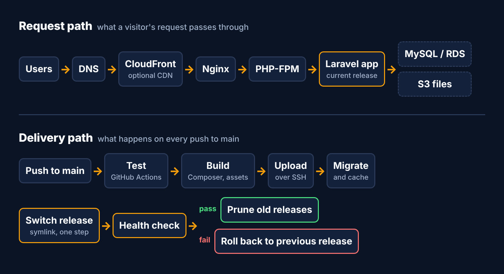

# laravel-aws-deploy

A small, readable deployment kit for running a Laravel application on a single
AWS server (EC2 or Lightsail) with GitHub Actions.

Push to `main` → tests run → the app is built in CI → uploaded over SSH →
migrated, cached and switched live atomically → health-checked → rolled back
automatically if the check fails.

It is deliberately plain: Bash, Nginx, PHP-FPM and one workflow file. No
agents, no extra services, nothing to learn before you can read what it does.



## What you get

| Path | Purpose |
|---|---|
| `workflows/deploy.yml` | GitHub Actions workflow: test, build, upload, deploy |
| `scripts/deploy.sh` | Server-side release script (atomic switch, health check, auto-rollback, pruning) |
| `scripts/rollback.sh` | Manual one-command rollback |
| `server/bootstrap-ubuntu.sh` | One-time server prep: packages, deploy user, directory layout |
| `server/nginx.conf.example` | Nginx site config, including the `$realpath_root` fix |
| `docs/architecture.md` | Request and delivery diagrams, and the reasoning behind the design |
| `docs/troubleshooting.md` | Layer-by-layer checklist for production problems |

## Quick start

**1. Prepare the server** (Ubuntu 24.04):

```bash
sudo ./server/bootstrap-ubuntu.sh deploy /var/www/app
```

Then add your CI public key to `/home/deploy/.ssh/authorized_keys`, create
`/var/www/app/shared/.env`, and enable `server/nginx.conf.example`.

**2. Add the workflow** to your Laravel project:

```bash
mkdir -p .github/workflows scripts
cp workflows/deploy.yml  <your-project>/.github/workflows/deploy.yml
cp scripts/deploy.sh     <your-project>/scripts/deploy.sh
```

**3. Add repository secrets** (Settings → Secrets and variables → Actions):

| Secret | Value |
|---|---|
| `DEPLOY_HOST` | Server IP or hostname |
| `DEPLOY_USER` | `deploy` |
| `DEPLOY_SSH_KEY` | Private key for the deploy user |
| `DEPLOY_KNOWN_HOSTS` | Output of `ssh-keyscan <host>` |

Optional repository **variables**: `APP_DIR` (default `/var/www/app`) and
`HEALTHCHECK_URL` (for example `https://example.com/up`).

**4. Push to `main`.**

## How a release works

1. CI runs your tests, then builds a production bundle (`composer install
   --no-dev`, frontend assets) so the server never needs Composer or Node.
2. The bundle is uploaded to the server and unpacked into a new directory under
   `releases/`.
3. `shared/.env` and `shared/storage` are linked in, `php artisan migrate
   --force` runs, and config/route/view/event caches are rebuilt.
4. The `current` symlink moves to the new release in one atomic step and
   PHP-FPM reloads.
5. If `HEALTHCHECK_URL` is set and does not return 2xx, the previous release is
   restored automatically.
6. Old releases beyond the last five are removed.

See [`docs/architecture.md`](docs/architecture.md) for diagrams and the
trade-offs.

## Limits to know about

- **One server.** This is not a zero-downtime multi-instance setup. For several
  instances behind a load balancer, use the same release layout per instance
  and deploy to them one at a time.
- **Migrations are not rolled back.** Rollback restores code only, so keep
  migrations backward-compatible for one release.
- **Secrets stay on the server.** `.env` lives in `shared/` and is never in the
  bundle or the repository.
- **Tested pieces.** Scripts are linted with ShellCheck in CI. Treat the first
  deploy on a new server as a rehearsal and try a rollback before you need one.

## License

MIT
