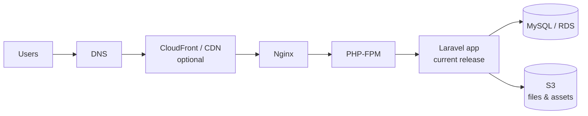
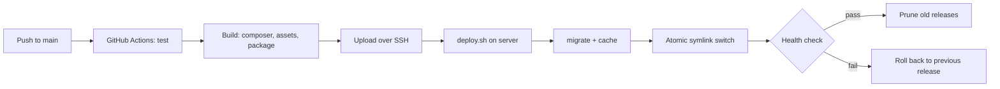

# Architecture

## Request path



## Delivery path



## Server layout

```
/var/www/app
├── current -> releases/20261008120000-ab12cd3   # Nginx serves this
├── releases/
│   ├── 20261008120000-ab12cd3/
│   └── 20261007093000-98ef76a/
└── shared/
    ├── .env          # linked into every release
    └── storage/      # linked into every release (logs, cache, uploads)
```

## Why it is built this way

- **Build in CI, not on the server.** The server never needs Composer, Node or
  Git credentials, so there is less to secure and less to break.
- **Releases in separate directories.** A deploy never edits live files, so a
  half-finished deploy cannot serve a broken mix of old and new code.
- **Atomic symlink switch.** Traffic moves to the new release in one step.
  Rollback is the same step in reverse.
- **`$realpath_root` in Nginx.** Without it, PHP-FPM and OPcache can keep
  serving the old release after the symlink changes.
- **Migrations run before the switch.** If a migration fails, the old release is
  still live. The consequence is that migrations must stay backward-compatible
  for one release (add columns before using them, drop them a release later).
